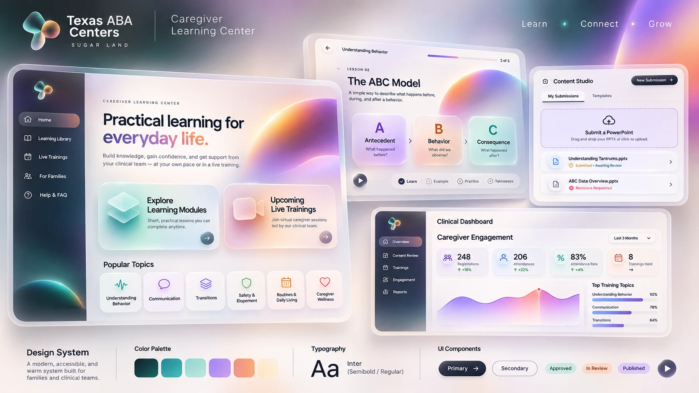
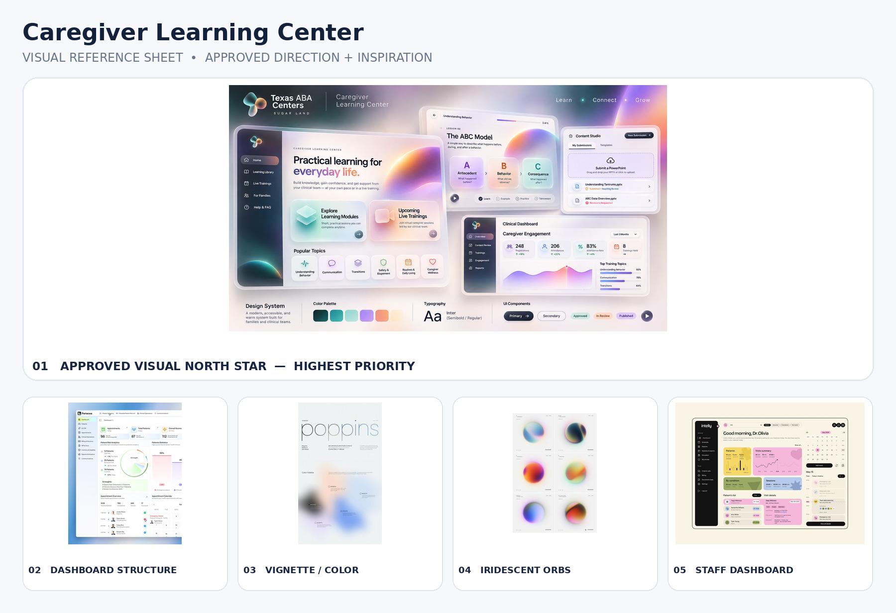

# CLAUDE CODE MASTER BUILD PROMPT
## Texas ABA Centers — Sugar Land Caregiver Learning Center
**Project designation:** Sugar Land pilot · educational website + protected staff workflow · design-approved prototype first
**Instruction priority:** This is the complete product/design/engineering brief. Read it all, then inspect every file in `references/`, especially `01_APPROVED_VISUAL_NORTH_STAR.png`, before touching the codebase. Implement the website; do not respond with only a plan, static image, or disconnected component examples.

> **Integration note, added November 18, 2026.** This product is now being built into the existing Texas ABA Centers site instead of as a standalone app. Read `INTEGRATION_BRIEF.md` first. Where it and this file disagree about routes, file locations, branding, fonts, token names, branches, flags or deployment, the brief wins. `DESIGN_REFERENCE_GUIDE.md` wins on visual values. Every function, safety, privacy, clinical-scope and approval rule in this file applies unchanged.

**Approved visual north star:**

**All supplied visual references at a glance:**

---

# 00 — YOUR ROLE, WORK STYLE, AND NON-NEGOTIABLE OPERATING RULES

You are the lead product designer, principal frontend engineer, thoughtful full-stack architect, accessibility specialist, and quality engineer for an ambitious learning platform. Your job is to turn a carefully planned product into a beautiful, highly intuitive, genuinely working experience. This is **not** a generic dashboard template or a medical records system. It is a modern caregiver education product with a restricted staff workflow.

The product owner has handled planning separately. You (Claude Code) own **implementation**. Treat the approved image as the visual north star and this brief as the functionality and safety contract.

**Before you code:**
1. Inspect the existing repo and determine whether this is a new application or an established one. Preserve anything functional and relevant; do not delete or rewrite unrelated systems.
2. Read `DESIGN_REFERENCE_GUIDE.md` and inspect all five supplied reference images. The approved final composition takes precedence over older examples.
3. Produce a concise implementation plan in the terminal/chat, then implement. State your assumptions and verify uncertain APIs against current official documentation. Ask only truly blocking questions; use safe, reversible defaults for everything else.
4. Distinguish **demonstration mode** from **production-ready integration**. We lack authorization to use corporate Microsoft 365 systems, identity, actual family information, official branding assets, and organization-approved hosting/storage. Build a remarkably complete functional prototype with synthetic data and an explicit production integration boundary. Never represent mocks as real data.
5. Never connect to real Microsoft Teams, access a clinical tenant, persist identifiable caregiver information, use client examples, expose sensitive data, or publish anything publicly without explicit organizational approval and credentials. Do not create accidental public storage buckets or open staff endpoints.
6. Do not mistake a high-fidelity UI for a finished product. Every important control should have meaningful behavior, or be explicitly disabled and labeled as requiring an integration. No fake success toasts, nonfunctional clickable cards, or fake data described as live.
7. Implement incrementally; run the app, lint/typecheck, test critical flows, and inspect the output visually at mobile and desktop sizes. Fix broken states, overflow, contrast, keyboard use, and routing before calling the milestone complete.
8. Do not overwrite environment secrets or trigger production migrations. Document required setup and keep `.env.example` sanitized.
9. Follow the existing project stack if suitable. If starting fresh, default to Next.js App Router, TypeScript, accessible React components, token-driven CSS/Tailwind, and maintainable modular architecture.

**Definition of success:** A parent who is tired, distracted, using an older phone, and not technologically confident can figure out in under 10 seconds how to (a) learn on their own or (b) view an upcoming live training. An RBT can submit a presentation without knowing how to code. A clinical reviewer can distinguish approved, unapproved, and revised content without ambiguity. The overall experience feels premium and futuristic but **never confusing or overdesigned**.

---

# 01 — PRODUCT THESIS AND AUDIENCES

## Product name
**Caregiver Learning Center** · Texas ABA Centers, Sugar Land pilot.

Use this as a **working project name**. Do not claim the organization approved an official product name, logo, domain, endorsement, or deployment. Use an easily replaceable organization-brand slot until authentic assets and authorization are provided.

## One-sentence purpose
A welcoming hub where families can access clinically approved, self-paced educational modules and register for live, BCBA-led or approved caregiver group trainings, while staff submit PowerPoints and clinical leadership controls approvals, events, and aggregate participation reports.

## Three perspectives

### A. Caregiver — main customer of the experience
- Find help with common ABA-related concepts without wading through clinical jargon.
- Browse public educational modules with no account.
- Learn one small step at a time with approved slides, plain-language explanations, fictional scenarios, supportive knowledge checks, and takeaway summaries.
- Find upcoming virtual group training events; request registration through the approved **Microsoft Teams event registration page**.
- Live training eligibility is **existing families only**; authorized clinic staff verify eligibility through approved internal procedures.
- The website must not require parents to prove eligibility or disclose child details to view **public** lessons.
- The site does not give individualized treatment advice, diagnose, replace their BCBA, or ask for personal clinical details.

### B. Contributor — RBT, apprentice, BCBA, or Clinical Director
- Sign in to a protected staff portal (using authorized organizational identity when available).
- Upload PowerPoint files (`.pptx`) with title, category, summary, learning objectives, author, and revision notes.
- Save drafts, submit for clinical review, see status, read feedback, revise, and resubmit.
- See the final published caregiver module they contributed to.
- **They do not build interactive lessons in a complex on-site editor for this pilot.** That plan was intentionally simplified.

### C. Clinical leadership — authorized BCBA or Clinical Director
- Review submissions, preview approved-source slides, request changes, approve or reject specific versions.
- Approve the **final interactive module a second time** after it is transformed externally.
- Oversee published content and withdraw content if necessary.
- Create and manage **website listings** for events that are actually scheduled and registered through Microsoft Teams.
- See aggregate caregiver participation analytics, not identifiable family-level reporting.

### D. Content producer — specifically assigned production permission
- After the original PowerPoint gets clinical approval, the project owner manually sends only an **approved, PHI-free** source to Claude, which transforms it into a polished interactive module.
- Producer imports or installs the generated module into the application in **draft / final-review** status, links it back to the approved PPTX source and version, and submits it to an authorized clinical reviewer.
- Producer cannot grant clinical approval simply by being the producer.
- **Do not build a direct Claude API integration, automatic AI course generation button, or complicated embedded slide editor as part of the initial MVP.**

---

# 02 — VISUAL NORTH STAR: READ THE IMAGE REFERENCES

Inside `references/`:
1. `01_APPROVED_VISUAL_NORTH_STAR.png` — **primary / decisive reference**. This is the exact visual direction the product owner enthusiastically approved. It shows a premium soft-glow, glassmorphic SaaS aesthetic; dark blue-teal navigation; warm/lavender frosted surfaces; iridescent, dimensional gradient orb; two prominent caregiver actions; a guided lesson card; staff content studio; and a leadership analytics dashboard. Reproduce its **design language and quality**, not its inaccurate/fake data or invented corporate logo.
2. `02_MODERN_HEALTHCARE_DASHBOARD_REFERENCE.png` — reference for information hierarchy, refined sidebar, lightly tinted metric cards, dense administrative design, and useful dashboards. Do NOT copy the patient database or use any patient-specific features.
3. `03_VIGNETTE_TYPOGRAPHY_COLOR_REFERENCE.png` — **critical**. The owner explicitly loves the large, diffuse atmospheric vignette / blurred color-field treatment here. Recreate this visual technique with restrained color gradients behind sharply readable foreground surfaces. This image also suggests clean, contemporary sans-serif typography and a palette including `#FADBCA`, `#D0E1F5`, `#242424`, `#76A1F3`, and `#E4DFF5`.
4. `04_IRIDESCENT_ORBS_REFERENCE.png` — inspiration for subtle translucent/iridescent shapes with blue, violet, rose, teal, and amber color interplay. Use as sparse art direction for a hero, atmospheric backdrop, or empty state; do not make the interface feel like a 3D art gallery.
5. `05_BOLD_DASHBOARD_REFERENCE.png` — inspiration for memorable rounded metric tiles, confident typography, strong navigation contrast, and polished editorial card composition; not a literal visual clone.

**The earlier cartoonish parent/child illustrated moodboards were explicitly superseded.** Do not create a childish preschool website, a generic medical admin template, or a rainbow of unrelated colors. This is a sophisticated, contemporary learning product with warmth and maturity.

**Reference priority:** `01` > the soft vignette/color principles of `03` > useful organizational cues of `02` and `05` > restrained 3D surface cues of `04`.

**Important asset rule:** The reference images are **design references**, not source files to display wholesale as the interface. Build real text, semantic controls, cards, navigation, charts, tabs, tables, and forms. No screenshots serving as functional pages. Do not reproduce third-party logos, names, distinctive branded layouts, or the artificial orb logo in reference 01 as if they are official Texas ABA Centers branding.

---

# 03 — CREATIVE DIRECTION: PREMIUM AND RADICALLY USABLE

## Design keywords
Atmospheric, precise, luminous, confident, sophisticated, calm, welcoming, glassy, accessible, responsive, editorial, surprisingly delightful.

## Visual hierarchy
- Clear, crisp, mostly white or very lightly tinted content planes in the foreground.
- Deep navy / teal anchoring major navigation regions.
- One controlled iridescent composition in the hero and very sparing accent uses elsewhere.
- Subtle soft-focus peach/lavender/blue/teal vignette **outside** key reading areas: corners, outer canvas, behind frosted cards.
- Large friendly headings and simple benefit-led language.
- Rounded components, but not oversized cartoon pills. Approximately 16–24px radius for large cards; smaller radii for input boxes.
- Fine, low-opacity borders, multi-layer soft shadows, generous internal padding.
- Visual clarity in mobile layouts takes precedence over desktop drama.

## Proposed token palette — adjust to maximize contrast and fidelity
- `--ink`: `#172138` dark main text
- `--navy-900`: `#0B1F3B` deep navigation / hero anchoring
- `--deep-teal`: `#103F4A`
- `--teal`: `#178A90` secondary brand energy
- `--mint`: `#BFECE8`
- `--lavender`: `#E4DFF5` (reference-derived)
- `--iris`: `#A78BFA` accent
- `--sky`: `#D0E1F5` (reference-derived)
- `--blue`: `#76A1F3` (reference-derived)
- `--peach`: `#FADBCA` (reference-derived)
- `--coral`: `#FF9E88`
- `--paper`: `#F8FAFD` near-white base
- `--white`: `#FFFFFF`
- `--muted-ink`: `#53637B` or carefully contrast-tested equivalent
- `--border`: a subtle slate/navy at around 8–12% opacity on opaque surfaces

Gradient accent examples: bluish lavender -> powder blue -> teal; peach -> soft coral -> lilac. Avoid a rainbow gradient behind every paragraph. Important text and controls must sit on contrast-safe opaque or sufficiently solid frosted layers.

## Typography
- Use **Inter** or a similarly clear modern sans as primary font; medium, semibold, and regular weights.
- Large product hero title: approximately 46–68px responsive, but shorter and clean on mobile; never make a parent scroll past a huge decorative hero before reaching the two main options.
- Desktop page headings: approx. 30–44px; mobile approx. 26–34px.
- Parent-facing body text: normally 17–18px with generous line height; avoid 11–13px informational text.
- Inputs/buttons: easily legible, not compact enterprise microtype.
- Uppercase micro-eyebrows may decorate headers but must not carry essential information.

## Motion
- Subtle hover elevation, soft card transitions, gentle background drift, extremely light orb parallax if performance allows.
- No autoplay media, flashing colors, obstructive moving gradients, infinite spinning objects, popups on landing, or motion required for navigation.
- Respect `prefers-reduced-motion` fully. Provide static gradients and still orb alternatives. Keep animation unobtrusive and low GPU cost.

## Responsive distinction
- **Caregiver:** simple top navigation and a direct main content area; hide advanced nav complexity; high visibility, big controls.
- **Staff:** left sidebar on desktop and a compact menu or bottom-sheet/drawer on mobile; denser screens allowed as long as still usable.
- **Leadership:** same system, with more tables/filters/review panels, still clean and responsive.

## Brand/visual QA rules
- Never let glow destroy contrast or obscure buttons.
- Do not use abstract colorful orbs as substitutes for meaningful images or explanations.
- Acknowledge official organizational logo/brand verification remains pending. Make it easy to swap in approved assets.
- Every interactive card has an obvious CTA and a clear accessible label.
- The parent interface must look friendly and approachable, not like a patient chart or billing portal.

---

# 04 — THE TWO PRIMARY PATHS: CAREGIVER HOMEPAGE

**Primary decision is final:** Self-paced modules and upcoming live trainings share **equal first-level prominence** on the homepage. Neither should be buried under the other.

## Desktop homepage anatomy (top to bottom)
1. Minimal branded header: Caregiver Learning Center, Learning Library, Live Trainings, Help & FAQ, and restrained staff sign-in entry. Do **not** place a prominent caregiver Login button because caregiver accounts are unnecessary.
2. Atmospheric hero on a bright frosted canvas with the message: **“Practical learning for everyday life.”** Supporting copy: “Build understanding at your own pace or join a live caregiver training with your clinical team.” Keep copy short and plain.
3. Two large, equally weighted choice cards above the fold:
   - **Explore Learning Modules** — “Short, interactive lessons you can complete anytime.” CTA: `Explore modules`.
   - **Upcoming Live Trainings** — “Virtual group sessions for currently enrolled families.” CTA: `View trainings`.
   Use different subtle iridescent color casts, clear icons, and large click targets.
4. Topic category browse section: Understanding Behavior, Communication, Routines & Daily Living, ABA Foundations, Safety & Elopement, Caregiver Support.
5. A few featured clinically approved modules with realistic time estimates, category, short description, and `Start learning`. No fictional user scores or fabricated reviews.
6. A compact upcoming trainings list: date/time in **America/Chicago**, topic, clinical presenter (only if approved), duration, `View details` / `Request registration`. If no events, meaningful empty state and a link to public lessons.
7. How learning works: `Choose a topic → Follow simple steps → Explore live training options` in three clean cards.
8. Need help section: Teams joining tips, where to find your registration email, contact your clinic through an **approved** official channel (no invented phone/email).
9. Accessible footer: educational-use statement, privacy, accessibility, official organization notice pending approval.

## Mobile requirements
- Hero shorter; two choice cards stacked with equal visual weight and large (at least ~44px high) actions.
- Topic discovery must be scannable. Prefer 2-column cards only if they still fit large labels; otherwise stack.
- No tiny floating search icon as only search affordance: label `Search learning topics` visibly.
- A thumb-friendly layout at 320–430px; no horizontal scroll.
- Never put live join details on a public page.

## Copy style
Warm, human, nonjudgmental, concrete. Avoid "fix your child," "eliminate tantrums," "behavior hacks," "guaranteed improvement," or implied individualized intervention. Use "understand," "recognize," "learn," "connect with your clinical team," "explore," and "support."

---

# 05 — PUBLIC LEARNING LIBRARY

## Catalog functionality
- Search across title, plain-language summary, and approved topic labels.
- Filter by category; optionally by time commitment and learning level.
- Featured / newest modules only when approved and genuinely available.
- Each module tile shows title, category, short description, rough duration, section count, and `Start learning`/`Continue learning` based on browser-local progress.
- Category landing pages should have an introductory explanation, not a clinical directive.
- Empty categories and no-search-results states must be useful; suggest other topics, clear filters, or browse all.
- Public library should only retrieve **approved published module versions**. It must not expose drafts, review notes, slide metadata, or draft asset URLs even by guessing URLs.

## Six initial categories
1. ABA Foundations — what ABA is, ABC data concepts, reinforcement basics, collaboration with BCBAs.
2. Understanding Behavior — recognizing observable behaviors, tantrums/distress, physical aggression concepts, understanding functions (without universal treatment rules).
3. Communication & Connection — communication attempts, functional communication, introduction to AAC, working with the clinical team.
4. Routines & Daily Living — visual schedules, transitions, morning/bedtime routines, self-help skills.
5. Safety & Elopement — safety awareness, identifying information to communicate to clinicians, seeking individualized safety plans; **not** public generic elopement intervention protocols.
6. Caregiver Support — caregiver collaboration, questions for clinical teams, how group training works, practical organization resources.

Do not fabricate medical authority or claim any unreviewed courses have been approved. For the demo, include **one fictional/clearly sample educational module** with obvious “DEMO · NOT CLINICALLY APPROVED” labeling, kept out of production-public release mode. Other items can be visibly labeled placeholders in demo environments, not silently shown as live offerings.

---

# 06 — GUIDED INTERACTIVE LEARNING PLAYER (THE CORE EXPERIENCE)

The product owner chose **guided, one-step-at-a-time lessons**, not a sprawling LMS or a static PDF page. The play experience must feel calm, satisfying, and easy to understand on a phone.

## Journey: module → lessons → steps → completion
1. **Module overview**: title, summary, time, 3–5 lessons, learning objectives, clinical reviewer/date once approved, related topic chips, `Start module`/`Resume`.
2. **Lesson introduction**: one concept, why it matters, optional `Next` and `Back`.
3. **Learning slides**: show an approved slide or slide-like visual in an accessible viewer with readable HTML narration/explanation. Allow next/previous and focus on the content.
4. **Simple explanation**: a short plain-language description immediately under the slide or as a separate guided step.
5. **Fictional scenario**: recognizable everyday example, explicitly hypothetical; not a client case.
6. **Knowledge check**: clear question, 2–4 plausible choices, one or more correct when appropriate, immediate **educational** feedback for each, unlimited retries, and ability to revisit the lesson. No shame, loud wrong-answer buzzer, pass/fail gating, scoreboards, or mandatory tests to access related content.
7. **Lesson takeaway**: one-to-three core ideas plus next lesson action.
8. **Module completion**: clear congratulations, key takeaways, related modules, optional matching upcoming live Teams training, and `Return to library`.

## Reader controls
- Always-visible simple progress indicator: `Lesson 2 of 4`, short segmented line, and back button.
- `Back`, `Next`, `Save and exit` (save locally), `Lesson outline` collapsible; no accidental loss.
- Keyboard, screen reader, and touch support; no horizontal wheel-only controls; hover cannot be required to see answers.
- No auto-advance or timers. Never auto-play videos.
- Preserve locally the current module and lesson step, completion flag, optional selected answer, and last visit time using browser local storage **without identifiers**.
- `Reset progress` option with confirmation. Clearly explain local progress is only saved on this browser/device and can be lost when browser data is cleared.
- An optional responsive inline slide thumbnail/lesson navigator may be used on desktop if simple; collapse it on mobile.

## Reusable step types
- `intro`
- `slide` (approved rendered image/HTML content, alt text/transcript, associated narration)
- `explanation` (rich accessible text / approved media)
- `scenario` (clearly fictional, non-clinical-specific example)
- `knowledge_check` (MC, multi-choice or simple true/false with feedback per answer)
- `takeaways`
- `related_module`
- `related_training`

## Data model considerations
- Course has immutable approved version; lesson has stable ID; step IDs stable across navigation.
- Each knowledge check has exact reviewed question text, choices, correct option set, and per-choice feedback; no AI runtime guessing.
- Related training must map to an actual published upcoming event, or not appear.
- Progress storage must use IDs/version so changes in the course do not corrupt progress. Have a safe reset/migration policy.
- Make course content **data-driven**, so later manual Claude conversions can be imported without rewriting the entire lesson player.

## Demonstration course (non-clinical production content)
Use **“Understanding the ABCs of Behavior”** as a clearly marked sample, with fictional scenario: a kitchen timer sounds, a child covers ears, an adult turns the timer off. Explain order of antecedent, observable behavior, consequence. A single observed sequence does **not** establish behavior function. Avoid suggesting an individualized response plan. Mark every sample educational screen “Demo sample — pending clinical approval,” and never ship it as approved content by default.

---

# 07 — STAFF PORTAL: CONTRIBUTORS (POWERPOINT-FIRST)

The proposed on-site full lesson creator was **replaced** by this simpler approach. Contributors create PowerPoints externally and submit the source file in the staff portal. Content producer transforms **only after** the original is approved. Support "both methods" only to the extent that the system accepts a manually produced interactive module package for final review; **do not** build a large in-browser slide design tool.

## Staff landing dashboard
- My submissions; tabs or filters `Draft`, `Awaiting review`, `Changes requested`, `Approved source`, `In production`, `Final review`, `Published`, `Archived`.
- Clear `Submit a PowerPoint` action.
- Each record shows title, topic, version, date, assigned reviewer, current status, recent feedback, and `Open`.
- Personal welcome not dependent on fake imported employee data.

## PPTX submission wizard
1. Title and short summary.
2. One of six categories, optional approved tags.
3. Educational objectives and intended audience.
4. PowerPoint upload area (`.pptx`); display filename/size; enforce configured size/type checks; provide upload status and understandable errors.
5. Checklist: no client identifiers, no case notes, no confidential clinical materials, plain-language objective, eligible contributor.
6. Review and submit.

## Submission rules
- Autosave draft or explicit `Save draft` with clear feedback.
- Drag/drop and standard browse button (never drag/drop only).
- On submission, freeze uploaded revision as an immutable version for review.
- Contributor may edit or replace **their own drafts**, and create a new version from a `Changes requested` result; cannot silently overwrite an in-review or approved version.
- Read-only review history for contributor; show feedback and next action.
- Before production integration: these features may run in secure **demo-mode with simulated/synthetic files**, and the app must label this clearly. Real storage needs organization-approved authentication, private storage, malware validation, and permissions.

---

# 08 — TWO-STAGE CLINICAL APPROVAL AND MANUAL CLAUDE CONVERSION

This is a major requirement: **approval of source PPTX ≠ approval of AI-transformed module**.

## Phase A — Source PowerPoint clinical review
`Draft → Submitted → In review → [Changes requested / Declined / Source approved]`

Authorized BCBA or Clinical Director sees:
- Submission metadata, contributor, version, original PPTX download/preview from protected storage.
- A structured review checklist: accuracy, scope, caregiver language, no PHI, appropriate examples, accessible materials, alignment with educational purpose.
- Options: `Request changes` with comments, `Decline` with explanation, `Approve source` with recorded reviewer/date/version.
- Protected audit log of actions and comments.
- Require reviewer permissions server-side; cannot self-approve by changing frontend controls.

## Phase B — External production via Claude
`Source approved → Awaiting production → In production → Module draft ready`

- Only a designated producer can mark/collect a clinically approved source for conversion.
- **The actual AI transformation happens manually outside the website.** The user provides an approved, PHI-free PowerPoint to Claude Code, who returns data-driven interactive lesson content/assets/code aligned to our schema.
- We do **not** give Claude an API key inside the website or add one-click generation.
- The producer imports the module package, declares source submission version, conversion date, generation method, and any new explanatory/scenario/question content.
- Validation catches broken references, missing feedback, missing alt text, invalid schema, and empty steps before submission to the final reviewer.

## Phase C — Final interactive module clinical review
`Module draft → Final review → [Changes requested / Rejected / Final approved] → Published`

- Reviewer previews the **actual caregiver interface**, not just the original PPTX.
- Reviewer checks all authored explanations, examples, knowledge check questions, feedback, slide rendering, and educational disclaimer.
- Reviewer approves the **exact immutable module version**.
- Only an explicitly authorized publisher can publish that approved version; producer permissions alone do not imply clinical approval.
- Any content-changing edit generates a new pending version, not a quiet mutation of the published course.
- Leadership can unpublish/withdraw immediately; public links show appropriate unavailable or archived state, never the old private version.
- Keep audit events for every review and publish action.

## Reviewer independence
Prefer separate reviewer from original author where possible; do not hard-code a clinic policy that has not been formally agreed. Make independent reviewer assignment configurable. Under no circumstances let RBTs or apprentices grant clinical approval.

## Approval record detail
- Submission/module unique ID and version hash or immutable version ID.
- Action (`approved`, `changes_requested`, `declined`, `published`, `withdrawn`).
- Actor user ID and role, timestamp, optional required comments depending on action.
- Source version and module version relationship.
- Clinical reviewer name/title may be visible on the public course page **only if approved**.

---

# 09 — CLINICAL LEADERSHIP DASHBOARD AND REVIEW QUEUE

The clinical dashboard is an **action center first, metrics second**.

## Dashboard zones
- At top: "Items needing review" with count and urgent but non-alarming status cues.
- Review queue with tabs `PPTX sources` and `Final modules` so the two approval gates never look identical.
- Upcoming Teams trainings/listings and `Manage events` shortcut.
- Aggregate engagement overview: registrations, actual attendances, event count, attendance ratio where accurately calculated.
- Published content overview and last review timestamps.
- Permissions and team administration are separate from clinical reviews, controlled by designated IT/system admin roles.

## Review page
- Left/main: original slide preview or final module preview.
- Right: author, version, source, checklist, review notes, action buttons.
- Make `Approve` distinct from `Request changes` and `Decline`.
- Avoid accidental approval: server-side validation and optional confirmation modal.
- Clear pending/success/error messages; preserve reviewer notes.
- Optionally show version comparison when newer revisions arrive; not mandatory for initial iteration.

---
# 10 — HYBRID MICROSOFT TEAMS EVENT MANAGEMENT

**Final decision:** The organization creates and manages the actual live event, registration, attendee approval, joining controls, and attendance reports **inside Microsoft Teams**. The website manages the **public event listing**, topic association, preview, statuses, and aggregate reporting. Do not build an unrelated duplicate booking platform.

## Event coordinator flow
1. Authorized organizer creates a Teams event of a type that supports the needed external registration and approval policies, **if available within organizational configuration**.
2. Organizer obtains the **official registration URL**, never the private attendee-specific joining URL.
3. BCBA/CD or event-management-authorized staff creates a website event listing:
   - Title, approved description and learning objectives.
   - Date, start and end in `America/Chicago`, including daylight-saving handling.
   - Presenter and role (only if approved), optional co-presenter.
   - Topic category and optional related approved modules.
   - Audience label: **Currently enrolled families only**.
   - Official Microsoft Teams registration URL.
   - Listing status: Draft / Scheduled / Registration closed / Completed / Cancelled / Archived.
   - Optional deadline/capacity only when known and reliably supplied by organizer.
4. Preview event listing, then publish in public training calendar.
5. Parent reads details and clicks `Request registration`. The website opens the official Teams registration workflow (new tab or navigation with clear label). No custom family-facing account or duplicate registration form in our site.
6. Authorized staff verify family eligibility **using approved internal organizational records** and approve/deny inside Teams, if permitted by their Teams rights and event settings.
7. Joining details are provided by the approved Teams workflow. The website does not show or manufacture a join link, nor assure that opening a URL confers admission.
8. After the event, authorized staff see the Teams report and manually enter **aggregate** approved counts into our website's analytics form. No attendee-identifying rows are imported.

## Website training listing card
- Date + time, timezone `CT`, clear event title, presenter, short summary, `Existing families only`, `View details`.
- Details page includes session expectations, participation policy, accessibility instructions, related learning modules, and a `Register through Microsoft Teams` CTA.
- If an event has no valid registration URL, do not show an active registration CTA; show `Registration details coming soon`.
- Past/closed events are clearly marked; no broken registration buttons.
- Cancelled event changes propagate visibly and accessibly. Consider manual `Last updated` status.
- Exact date and time must never be fabricated in demo copy; use clear "Example event" + symbolic demo dates, or no dates until seeded. No fake real clinician names.

## Teams unknowns requiring IT verification
- Tenant license, Teams Events/webinars availability, event configuration and registration question capabilities.
- Which organizational roles are authorized organizers and who can see reports.
- External caregiver registration, manual registration approval, lobby/bypass controls, forwarded-link behavior, event privacy and meeting settings.
- Retention/recording rules, attendance report access, accessibility/interpretation, staff identity, approved hosting and data-handling processes.

Build **adapter interfaces** for future Microsoft integration, but do not assume a particular Graph API authorization flow works before validation. Official Microsoft docs change; research current docs when actually integrating. The MVP can be fully useful through manual registration URL insertion and manual aggregate reporting.

---

# 11 — ANALYTICS: AGGREGATE CAREGIVER PARTICIPATION ONLY

**Clinical Director's explicit decision:** They want participation/engagement **trends**, **not** reports showing which specific families attended. Never build an identifiable family-level attendance table, email/child-name search, caregiver profile, or individual attendance history in this reporting portal.

## Dashboard metrics
1. Training registrations (count of registrations submitted; label definition clearly).
2. Approved registrations (count accepted into the training, if available and reconciled).
3. Actual attendances / attendee count for each event (as Teams defines it; do not imply deduplication across sessions).
4. Attendance rate only when calculation is meaningful and numerator and denominator use comparable definitions. Prefer "Attended / Approved registrations" if verified; otherwise show counts separately or use accurately labeled approximate registration-to-attendance ratio.
5. Trainings held in selected interval.
6. Most-attended topics by aggregate counts.
7. Participation over weeks/months.
8. Optional aggregate center affiliation and referral-source breakdown **when organizers have collected it with appropriate notice** and aggregated it safely.
9. Anonymous public educational engagement may include page views and module starts/finishes *only if approved, privacy-preserving analytics are later enabled*. Do not infer individual completion from browser-local progress.

## Report filtering
- Last 30 days, last 90 days, year-to-date, and arbitrary date range.
- By event/topic; optional center/registration source only when counts robust enough to avoid reidentification.
- Print-friendly report or CSV of **aggregate figures only**, not raw Teams attendee files.

## Data-entry form for authorized staff
- Event selected from published/completed event listings.
- Date report was reviewed; source `Microsoft Teams organizer report` or other approved source.
- `registrations_total`, `registrations_approved`, `attendances_total`, `training_held` boolean; counts must be nonnegative integers.
- Optional category source totals and affiliate center counts; must reconcile to a declared appropriate total or show clear non-exhaustive label.
- Reviewer/entered-by audit metadata for staff accountability.
- Display contextual guidance: these are aggregate counts; do not paste names, emails, attendance spreadsheets, or protected information.

## Privacy safeguards
- No identifiable family records in public website database or aggregate analytics database.
- Do not send third-party analytics identifiers tied to attendance or course progress.
- Segments with fewer than a policy-approved minimum (propose 5, configurable by compliance) should be merged into `Other / not displayed`, never displayed as 1–4 in narrow center/source slices. Validate risk of reverse inference through totals and cross-filters as well.
- Role restrict dashboard access even if metrics are aggregate.
- Provide a report definitions glossary to avoid misleading interpretations.

## Dashboard visuals
Use elegant compact metric tiles, a single understandable trend chart, accessible chart labels/data table, topic comparison, and a small summary. The references show illustrative numerical content, **not actual clinic data**. In demo mode, a visible top-level banner indicates `Illustrative demo data — not actual caregiver attendance`.

---

# 12 — ROLE-BASED AUTHORIZATION AND ACCOUNT MODEL

There are three UX perspectives, but the underlying staff authorization needs more granular capabilities. Recommend capability-based grants, not hard-coded assumption that every BCBA sees every permission.

| Capability | Caregiver public | RBT/apprentice | Assigned BCBA reviewer | Clinical Director | Content producer | IT admin |
|---|---:|---:|---:|---:|---:|---:|
| Browse approved public modules | Yes | Yes | Yes | Yes | Yes | Yes |
| View live training listings | Yes | Yes | Yes | Yes | Yes | Yes |
| Request event registration via Teams | Eligible families | No special staff role | Optional | Optional | Optional | No special role |
| Upload/edit own PPTX draft | No | Yes | Yes | Yes | If contributor | Configurable |
| Submit a PPTX for review | No | Yes | Yes | Yes | If contributor | Configurable |
| View all assigned source reviews | No | No | Yes | Yes | No, unless assigned | Not automatically |
| Approve educational content | No | No | If assigned | Yes | No, unless independently authorized | No |
| Import derived module draft | No | No | If specifically assigned | If assigned | Yes | Not automatically |
| Publish approved module version | No | No | If assigned | Yes | If separately assigned publisher | No, unless separately granted |
| Create/update website event listing | No | No | If assigned | Yes | If assigned | Not automatically |
| Enter/view aggregate attendance | No | No | If assigned | Yes | Not by default | Not automatically |
| Manage technical accounts/settings | No | No | No | Via approved governance | No | Yes |

**Important:** Never assume an IT/system admin automatically has clinical approval authority. Separate technical admin from clinical signoff.

Authentication direction:
- Production staff identities must use organization-approved access controls, ideally SSO through the organization's existing identity provider (likely Microsoft Entra ID if approved, not yet confirmed).
- Authorization checked on the server/API/database for every restricted action and file access, not only by hiding navigation.
- No parent accounts for public modules or webinar browsing.
- Demo mode may provide seeded fictional role switcher **only inside a clearly marked local development environment**. Never expose a public role switcher or pretend it is real authentication on a live deployment.
- Role changes, access revocations, stale sessions, and file download authorization must be handled.

---

# 13 — SITEMAP AND ROUTE PLAN

You may adapt exact route names to the existing app, but preserve information architecture and deep links.

## Public
- `/` — caregiver homepage with two equal learning paths.
- `/learn` — searchable learning library.
- `/learn/[moduleSlug]` — module overview and lesson outline.
- `/learn/[moduleSlug]/lesson/[lessonId]` — interactive guided player (step state may live in query/hash/client state; back/forward browser history must work).
- `/trainings` — upcoming training listings/calendar; list view always available, not calendar-only.
- `/trainings/[eventSlug]` — training details with Teams registration handoff.
- `/help` — parent-friendly FAQ + how to use Teams/how to use lessons.
- `/privacy` — draft privacy notice placeholder pending organizational review (do not invent a compliance attestation).
- `/accessibility` — accessibility help/statement placeholder pending approval.

## Restricted staff
- `/staff` — overview based on capabilities.
- `/staff/submissions` — my submissions and accessible status list.
- `/staff/submissions/new` — PPTX upload submission flow.
- `/staff/submissions/[id]` — submission history, feedback, and versioned source details.
- `/staff/reviews` — assigned source/final-module review queue.
- `/staff/reviews/[id]` — review page and immutable decision controls.
- `/staff/modules` — module inventory, approval state, owner, source links.
- `/staff/modules/[id]` — derived module preview/import metadata and final review state.
- `/staff/trainings` — Teams website listing management.
- `/staff/trainings/new` and `/staff/trainings/[id]` — event listing editor.
- `/staff/analytics` — aggregate participation dashboard.
- `/staff/settings` — scoped team/site settings, depending on capability.

## Non-production demonstration routes
If real staff authentication/storage is not configured, use a **separately gated demo mode** with fictional staff personas and data. Do not claim `/staff` is protected in a secure production sense unless it really is. Configure the demo explicitly, make it visually obvious, and make production builds fail closed for unconfigured privileged routes.

---

# 14 — SUGGESTED COMPONENT ARCHITECTURE

Follow existing repo conventions when present. Otherwise:

## Shared UI system
- `AppShell`, `PublicHeader`, `StaffSidebar`, `MobileNav`, `Breadcrumbs`
- `AuroraBackdrop`, `SoftVignette`, `IridescentOrb` (noninteractive, optional, low-cost)
- `GlassCard`, `SurfaceCard`, `ModuleCard`, `TrainingCard`, `MetricCard`
- `PrimaryButton`, `SecondaryButton`, `StatusBadge`, `EmptyState`, `LoadingState`, `ErrorState`
- `AccessibleTabs`, `Dialog`, `FormField`, `SearchInput`, `FilterBar`
- `DataTable`, `ChartWithDataTable`, `DateTimeDisplay`

## Caregiver
- `HomeHero`, `LearningPathChoice`, `TopicGrid`, `FeaturedModules`, `UpcomingTrainings`
- `LearningCatalog`, `ModuleOverview`, `LessonPlayer`, `LessonProgress`, `StepRenderer`
- `SlideBlock`, `ExplanationBlock`, `ScenarioBlock`, `KnowledgeCheck`, `TakeawayBlock`, `ModuleCompletion`
- `TrainingDetails`, `ExternalTeamsRegistrationLink`, `ParentHelpFAQ`

## Staff
- `SubmissionDashboard`, `PowerPointUploader`, `SourceSubmissionForm`, `ReviewStatusTimeline`
- `ClinicalReviewQueue`, `SourceReviewPanel`, `FinalModuleReviewPanel`, `ApprovalHistory`
- `ModuleImportPanel`, `ModulePreview`, `ModuleValidationReport`
- `TrainingListingForm`, `TrainingStatusControl`, `RelatedModulePicker`
- `EngagementOverview`, `AggregateMetricsForm`, `PrivacySafeBreakdown`

## Architecture design rules
- Define stable domain types and schemas before UI hardcoding.
- Route/loaders never return unpublished module content to the public bundle or unauthenticated API.
- Persist approved module versions, not dynamically generated clinical wording.
- Keep event listing and Teams registration as separate entities connected through a safe official registration link.
- Use one consistent date formatter/time-zone utility; do not rely on server timezone.
- The demonstration should use a seed-data adapter that can later be swapped for authorized production services.

---

# 15 — DATA MODEL / STORAGE CONCEPT (FLEXIBLE IMPLEMENTATION)

You may choose a different schema if more robust, but you must support these logical entities and constraints. Do not migrate a real database until authorized.

## `staff_profiles`
`id`, `display_name`, `staff_role`, `clinic_scope`, `status`, `identity_provider_subject`, timestamps. Do not store password plaintext or duplicate identity credentials.

## `staff_permissions` / `role_capabilities`
Explicit capability grants, organizational scope, revocation and optional reviewer assignment.

## `ppt_submissions`
`id`, `created_by`, `category_id`, `title`, `summary`, `learning_objectives`, `current_version_id`, `workflow_status`, timestamps.

## `ppt_submission_versions`
`id`, `submission_id`, `version_number`, `private_asset_id`, `file_name`, `file_hash`, `revision_notes`, `created_by`, `created_at`, `immutable_after_submit`.

## `private_assets`
`id`, `private_object_key`, `mime_type`, `byte_size`, `scan_state`, `linked_version_id`, approved-access metadata; storage must be private with scoped temporary file access. Do not store open public URLs for pending PPTX files.

## `clinical_reviews`
`id`, `target_type` (`source_pptx` or `derived_module`), `target_version_id`, `reviewer_user_id`, `decision`, `checklist_results`, `comments`, `decided_at`. Never use one review record to approve both source and derived module.

## `learning_modules`
`id`, `slug`, `title`, `category_id`, `summary`, `estimated_minutes`, `published_version_id`, `publication_status`, timestamps.

## `learning_module_versions`
`id`, `module_id`, `version`, `source_ppt_version_id`, `created_by_producer`, `generated_with_external_ai` flag, `module_manifest`, `clinical_approval_ref`, `created_at`, `published_at`, `retired_at`. Approved/published content immutable.

## `module_manifest` format
Use a typed, versioned structured format that supports:
- Module ID/slug/title/summary/category/objectives/read-time.
- Ordered lessons with stable IDs.
- Ordered blocks per lesson with stable IDs; blocks of `intro`, `slide`, `explanation`, `scenario`, `knowledge_check`, `takeaways`, `related_training`.
- Localization-ready string fields for later translation.
- Accessible descriptions, content source attribution when supplied, and known review date.
- Knowledge check answer keys and **per-choice** feedback.
- Safe mapping to related published modules/events; no plain copied unreviewed HTML that can execute scripts.
- Schema version and validation to allow future imports from Claude.

## `website_training_listings`
`id`, `slug`, `title`, `approved_description`, `start_at_utc`, `end_at_utc`, `local_timezone` (`America/Chicago`), `presenter_label`, `registration_url`, `registration_status`, `listing_status`, `created_by`, timestamps. Avoid storing attendee join URLs, personal registration tokens, or raw attendee exports.

## `training_related_modules`
`event_id`, `module_id`, optional sort order; only published/approved module relationships may display to caregiver.

## `training_aggregate_reports`
`id`, `event_id`, `report_date`, `registrations_total`, `registrations_approved`, `attendances_total`, `source_label`, `entered_by`, `reviewed_by`, timestamps. Optional `aggregate_center_counts` and `aggregate_referral_counts` stored only in approved non-identifying form. No individual registrant names/emails or PHI.

## `audit_events`
`id`, `actor`, `action`, `target_type`, `target_id`, `target_version_id`, `timestamp`, safe metadata. Do not log sensitive raw file contents, signed URLs, tokens, or potentially identifying material.

## `categories` and controlled vocabularies
Topic names, display order, public visibility, icons; immutable IDs behind labels.

**Storage principles:** Prefer explicit source-version relations and immutable review snapshots. Minimize stored data. Production storage/vendor selection requires organization approval. Keep schema and adapters independent of any particular unauthorized personal account.

---

# 16 — SAFETY, PRIVACY, AND CLINICAL SCOPE

This is for a healthcare organization. It is an **educational** platform, not a medical record, therapy implementation engine, diagnostic tool, or portal for discussing an individual child's case. Its public learning resources must not claim to replace a BCBA's individualized treatment plan.

## Required scope boundary
On modules and appropriate site locations include a short, human-readable statement in the spirit of:
> “These educational resources support general learning. Your child's supervising BCBA is responsible for individualized recommendations and treatment planning.”

The exact official wording is subject to organization/clinical review.

## Never collect or publish
- Child names, birthdates, diagnostic records, behavior plans, therapy notes, medical history, identifiable photos/videos, family case studies without formal approved process, school records, or clinical reports.
- Protected health information embedded in presentation metadata, presenter notes, comments, hidden slides, screenshots, document history, or file properties. Warn that uploading protected material is not permitted; client-side warning alone is **not** a substitute for staff training and security review.
- Personalized live training chat transcripts or recordings in public education pages by default.
- Individual learner quiz answers or identifiable completion history.
- Identifying Teams registrant lists in our website's aggregate reporting storage.

## Higher-risk public topics
Tantrums, physical aggression, elopement, self-injury, restraint, and crises require particular care: present general education and clinical collaboration only, with warnings to seek appropriate individualized professional guidance. Do not create generic treatment protocols, restraint instructions, or guarantees.

## External AI boundaries
The product owner manually uses Claude for approved PPTX-to-module production. Do not automatically transmit uploads or approval notes to external AI. Only sanctioned, PHI-free, approved material may be used in authorized external tools. The generated output must be subject to second clinical review, even if it appears faithful to source.

## Technical safeguards before any real operational use
- IT/compliance approval, appropriate agreements and vendor assessments as required by organization.
- Organization-approved hosting and document storage.
- Real organizational identity and server-side authorization.
- Private PPTX file storage, upload-type/size limits, malware scanning, safe file handling, restricted previews and signed short-lived downloads.
- Strong session handling, CSRF protections where relevant, validation, output encoding, injection/XSS defenses, secure logging, rate limits, backup/restore, audit trails, retention rules.
- Privacy policy and public communication approved by the organization.
- No public demo staff permissions or personal cloud database holding clinic submissions.
- Error messages must not leak sensitive filenames, internal IDs, access tokens, or storage keys.

---

# 17 — ACCESSIBILITY AND LOW-TECH-LITERACY DESIGN CRITERIA

Target **WCAG 2.2 AA** as an engineering standard, not simply a legal footer claim. In testing, prioritize actual parent usability.

## Must-haves
- Keyboard operability for all controls; visible focus rings.
- Text contrast at least 4.5:1 for normal body text; UI/icon contrast and large type per applicable WCAG rules. Check real colors against translucent gradient backgrounds, not theoretical swatches.
- Semantic headings, labels, form errors, aria-live updates for quiz feedback, descriptive button text.
- No information conveyed through color alone: badges include words/icons and readable status labels.
- Large touch targets; **aim for 44×44 CSS px or greater for primary mobile actions**. Avoid tiny chevrons as the only click region.
- Content reflow at 320px and 200% zoom with no essential information lost or horizontal scroll.
- No time-limited quizzes or mandatory gesture-based interaction.
- Clear alternative text / descriptions for slides, figures and visual learning materials; do not treat a screenshot of text as an adequate substitute for real accessible HTML.
- Captions and transcripts if media becomes part of a course.
- Respect reduced motion and low-powered mobile devices.
- Consistent form field names and language. Explain registration handoff: `You will continue to Microsoft Teams to register`.
- Helpful error messaging with plain next steps, not system codes.

## Parent usability tests (prototype)
Show the site to someone unfamiliar with it. Can they independently:
1. Find a self-paced lesson from home?
2. Find an upcoming live training?
3. Understand who can register?
4. Navigate backwards in a lesson and resume later?
5. Answer a knowledge check without feeling graded or blocked?
6. Find help if a Teams email does not arrive?
7. See that general education is not individualized clinical care?

## Content reading standard
Write in straightforward, empathetic English; prefer short sentences and one concept per step. Explain acronyms the first time (`Applied Behavior Analysis (ABA)`, `Board Certified Behavior Analyst (BCBA)`, `antecedent–behavior–consequence (ABC)`). Consider later Spanish translation as a separate, clinically reviewed project; do not ship machine-translated clinical content without review.

---

# 18 — COPYWRITING AND INTERACTION TONE

**Voice:** Clear, confident, gentle, encouraging, not patronizing. Direct, concrete call-to-action labels.

Good examples:
- "Practical learning for everyday life."
- "Explore lessons at your own pace."
- "Join an upcoming caregiver training."
- "You can always come back to this lesson."
- "Let's look at what happened immediately before the behavior."
- "This training is available to currently enrolled families."
- "You’ll complete registration through Microsoft Teams."
- "Your progress is saved on this device."

Avoid:
- "Unlock the secret to fixing behaviors."
- "Guaranteed results!"
- "Get certified in ABA in 10 minutes."
- "We track each family's learning outcomes."
- "Join now" if that button bypasses actual registration.
- Clinical jargon on first glance, fabricated clinician credentials, fake dates, fabricated endorsements.

Empty states should be useful:
- No upcoming events: "There aren't any live trainings listed right now. You can still explore our learning modules."
- No approved modules: "Resources are being prepared for clinical review. Check back for new learning materials."
- No submissions: "You haven't submitted a presentation yet. Start with a PowerPoint you created."
- No pending reviews: "You're all caught up on assigned reviews."
- No analytics data: "Participation reporting will appear after a completed training and approved totals have been entered."

---

# 19 — UX DETAILS AND EDGE CASES YOU MUST NOT MISS

### Parent library
- Slow network and loading skeletons.
- Search has clear button, empty results, keyboard support.
- Broken content image/slide fallback displays equivalent HTML explanation.
- Browser reload restores lesson progress without identifiers.
- Local storage disabled/private mode: app still works, shows honest unsaved-progress note.
- Completion of an archived/replaced version: explain a newer approved version is available; don't restore into inconsistent steps.

### Event pages
- Missing Teams registration URL: CTA disabled with explanatory text.
- Link malformed/untrusted: reject invalid schemes/domains and warn staff; do not auto-save arbitrary javascript links. Admin can verify approved Teams URL origin.
- Event in the past: remove active registration; show `Completed` and relevant module link.
- Cancelled event: high-visibility, non-alarmist status; never suggest the event is still occurring.
- Time zone clearly labeled Central Time; display date/month/day/year and CT without ambiguity; account for DST.
- Unavailable training capacity: only display grounded status, not guessed seats.

### Staff submissions
- Unsupported `.ppt`, corrupted `.pptx`, file too large, virus scan pending/failure, duplicate names, loss of connection mid-upload, and unauthorized access.
- Revisions requested after source approval: new source version must go through approval and may invalidate pending derived module work. Do not silently replace published output.
- Contributor removes a draft: use confirmation, but preserve previously reviewed audit records per retention policy.
- File upload success must be verified server-side, never fake.

### Review workflow
- Two reviewers opening same item simultaneously: prevent stale overwrites with version checks.
- Approval from a logged-out/expired reviewer fails safely.
- Approve button requires exact version and completed checklist; notes requirements depend on decision.
- Producer cannot promote `module draft` to `published` without final clinical approval.
- Public path for unpublished module returns a safe unavailability page, not hidden data.

### Analytics
- Blank / missing values are "Not yet available", not zero unless actually zero.
- Avoid using percentages from mismatched registration and attendance counts.
- A single caregiver attending three sessions may yield three attendances. Label metrics accurately.
- Small cohorts do not display fine-grained center/source breakdowns.
- Manual aggregate totals can be corrected with reason and audit history.

---

# 20 — TECHNOLOGY AND INTEGRATION BOUNDARIES

## Preferred starting point if repo is new
- Next.js App Router (supported current stable), TypeScript, React.
- Tokenized CSS variables and Tailwind or existing equivalent; component primitives chosen for accessibility.
- Lucide-style iconography; consistent stroke weights.
- Accessible dialogs/forms/tabs/selects; no dependence on mouse hover alone.
- A minimal animation library only where needed; CSS for simple effects, respect reduced motion.
- Charts can use an accessible established React chart library or semantic HTML tables alongside visuals.
- Typed server-side route handlers/actions and input schema validation. Keep privileged actions server-only.
- Favor explicit, typed, testable modules over enormous page components.

## Do not assume
- Personal Supabase/Vercel accounts are approved for this healthcare organization.
- Current Teams licensing supports every desired event approval capability.
- Microsoft Graph event APIs can be called with a personal token without IT approval.
- A file uploaded by a staff member is clinically approved, sanitized, or suitable to transmit externally.
- The final generated reference logo is official branding.

## Adapter pattern
Create logical interfaces (or their practical equivalent) so the demo and eventual approved production adapters can be swapped:
- `ContentRepository`
- `PrivatePresentationStorage`
- `StaffIdentityProvider`
- `ApprovalWorkflowService`
- `PublishedModuleRepository`
- `TrainingListingRepository`
- `AggregateReportingRepository`
- `TeamsRegistrationLinkValidator` / optional future `TeamsEventAdapter`

The prototype should not require API keys to render its public site or demonstrate seeded staff workflows. Real upload/approval persistence can be added once infrastructure is authorized. If you choose to write a local or mock backend for demonstration, clearly segregate it from real-world deployment and document security limitations.

---

# 21 — VISUAL SYSTEM IMPLEMENTATION DETAILS

## Soft vignette backdrop: the user's signature preference
Recreate a **sophisticated atmospheric field** from reference 03:
- Multiple large diffuse radial gradients (ice blue, indigo/lavender, dusty peach) with significant blur/low opacity.
- The blurred colors sit at edges and behind glass cards with a white/faint-blue canvas.
- Add tasteful dark blue-teal region to anchor sidebar or scene; transition delicately into warm lavender and coral accents.
- Preserve large areas of quiet white space for reading.
- Avoid hard-edged multicolor backgrounds, repeated glowing blobs behind every item, rainbow text, or neon overload.

## Glassmorphism
- White or very lightly tinted surfaces with subtle translucent quality.
- Borders 1px transparent/slate; a controlled shadow stack; optional backdrop blur where supported.
- Parent cards use more opaque surfaces than decorative/hero elements; critical body copy never competes with the gradient.
- Test browsers without backdrop-filter support and provide opaque fallback.

## Approved orb aesthetic
- One carefully composed iridescent orb/hemisphere in the hero or tasteful abstract corner.
- No inaccurate medical-looking anatomical visuals.
- Use CSS/SVG gradients or approved asset export; don't simply crop the reference UI. Consider performance and accessibility; purely decorative orb has empty alt.

## Staff visual language
- Dark, elegant sidebar with simple text icons.
- Staff main canvas white/lavender tinted.
- Approval status chips use words and accessible contrast, not just color; approved green/teal, pending violet/amber, revisions coral, archived neutral.
- Tables are clean and comfortable with readable font sizes, generous row height, keyboard support, and responsive card alternatives.

## Microinteraction examples
- Choice cards tilt or lift at most a little; reduce motion on request.
- Knowledge check answer selection produces gentle feedback state rather than celebratory confetti.
- Module completion uses a subtle glowing ring or check icon, not a noisy animation.
- Forms provide calm, explicit validation; user always knows whether a draft was saved or submitted.

## Design QA rubric (evaluate yourself)
Score each 1–5 and iterate until no major weakness:
1. Visual alignment with approved north-star image.
2. Accuracy of soft atmospheric vignette from reference 03.
3. Readable hierarchy at first glance.
4. Mobile ease for non-tech-savvy caregiver.
5. Contrast/accessibility including reduced motion.
6. Polished and consistent glass/gradient execution.
7. Cohesion between public, contributor, leadership experiences.
8. Real functionality behind visible controls.
9. Clinical approval state clarity and security.
10. Emotional tone: supportive, professional, not childish.

---

# 22 — PHASED BUILD EXECUTION PLAN

**You should do the actual implementation, not merely reiterate this roadmap.** Work in logical phases, run tests, and explain blockers. When external credentials are unavailable, implement and verify the bounded demo version and document integration tasks rather than inventing success.

### Phase 0: Repo inspection and foundations
- Inspect repo and toolchain.
- Document decisions/assumptions.
- Create tokens, fonts, reusable visual primitives, responsive shells.
- Establish demo/prod boundaries and basic types.
- Show/verify first visual screen before overbuilding the rest.

### Phase 1: Caregiver-facing experience
- Build homepage (balanced modules + trainings), library, categories, module detail, guided lesson player, help, training list/detail.
- Provide realistic but visibly **sample** educational course and sample event listing for demo.
- Local-only progress, accessible quiz and navigation, empty/error states.
- Make mobile experience excellent.

### Phase 2: Staff contributor prototype
- Build sign-in/role-gated **demo workflow**, submissions list, new PPTX submission UI, file validation mock or approved local storage, status and revision/history views.
- Ensure true production routes fail closed when real security isn't configured.
- Implement realistic draft → submitted → feedback → revised state transitions using synthetic data.

### Phase 3: Clinical leadership and producer workflows
- Review queue: source vs final-module review.
- Review details, checklist, changes requested, decline, version-bound approval, immutable audit history.
- Module production tracking, import schema validation, final module review, publication/unpublication.
- Permissions by capability, not just UI.

### Phase 4: Events and reporting
- Authorized event listing CRUD UI with safe official Teams registration URL (no actual tenant connection).
- Relate published modules to events.
- Aggregate metrics form, calendar/list, monthly dashboard, privacy-safe segments, demo chart.
- Role-based access to report entry and viewing.

### Phase 5: Hardening, QA, and handoff
- Accessibility audit and real browser testing desktop/mobile.
- Security tests for protected routes/action boundaries.
- Unit tests for state transitions, module validation, URL validation, and metrics calculation.
- Integration / browser automation tests for core journeys.
- Document missing organizational approvals and future integration work.
- Produce concise README, setup instructions, demo mode notes, acceptance results, and any limitations.

**No unauthorized public production launch.** You may run locally and create preview artifacts in an appropriate environment. Ask the user before deployment, brand/legal activation, using an actual company domain, collecting family data, or making real Microsoft tenant calls.

---

# 23 — ACCEPTANCE TESTS: THIS PRODUCT MUST PASS THESE

## Caregiver acceptance
- [ ] Landing page instantly shows **both** learning and live training paths with equally strong visual hierarchy.
- [ ] Navigation works on 320px mobile, tablet, and wide desktop without horizontal overflow.
- [ ] Public user can search and open a published module without a login.
- [ ] Guided player visibly shows position, back/next, and lesson outline.
- [ ] Knowledge check supports selection, accurate specific feedback, retries, accessible labels, and no gating.
- [ ] Refresh resumes progress locally when enabled; privacy notice explains device-local behavior.
- [ ] Screen-reader labels and keyboard navigation work.
- [ ] Related upcoming live events appear only when actually linked to that approved module.
- [ ] Public event listing clearly says **currently enrolled families only**.
- [ ] Registration CTA points to validated official event registration URL, never an attendee join URL.
- [ ] No child-specific information is asked on public lessons/site registration UI.

## Contributor acceptance
- [ ] Staff demo role sees their own submissions and their exact status.
- [ ] Contributor can start a PPTX draft, supply metadata, and submit only when required fields are valid.
- [ ] Unsupported file/oversized file feedback is clear.
- [ ] Contributor cannot self-approve, alter frozen review version, publish content, or access privileged reviewer routes.
- [ ] Changes requested enable revised submission and preserve previous reviewed version.

## Clinical reviewer/producer acceptance
- [ ] Source and final-module approvals are **separate actions and separate review records**.
- [ ] Clinical reviewer can see version, checklist, preview and feedback.
- [ ] Approved source is available to permitted producer for manual conversion.
- [ ] Producer can import or register a derived module and attach correct approved source version.
- [ ] Derived module cannot publish without explicit final clinical approval of that precise version.
- [ ] Withdrawn module disappears from public lessons but stays in authorized audit history.
- [ ] Reviewer authority is checked server-side, not a visible badge.

## Event acceptance
- [ ] Admin can draft, publish, close, cancel and archive a website listing.
- [ ] Data model separates Teams registration URL from any join URL.
- [ ] Date display uses CT and handles DST correctly.
- [ ] Empty events/calendar behave properly.
- [ ] Invalid/missing link cannot be clicked as if active registration.

## Analytics acceptance
- [ ] Only aggregate counts enter reporting storage; no attendee rows, emails or names.
- [ ] Counts and ratios use defined calculation and correct denominator.
- [ ] Small segment suppression/combination prevents display of very small cells and inferable complements.
- [ ] Staff can see report source and revision audit details.
- [ ] Demo figures are unmistakably demo figures.

## Visual acceptance
- [ ] Looks convincingly aligned to reference 01 — not a generic admin template.
- [ ] Has elegant soft diffuse vignette fields inspired by reference 03.
- [ ] Main caregiver UI is calmer and simpler than staff/leadership UI.
- [ ] Responsive typography and contrast are readable everywhere.
- [ ] Abstract orb art is tasteful and does not obscure UX.
- [ ] Reduced-motion and low-performance fallbacks work.

---

# 24 — WHAT TO PRODUCE AND REPORT WHEN YOU FINISH

Deliver a functioning, locally runnable codebase that is well structured, accessible, and visually distinctive. Include:

1. The actual source code and reusable design system.
2. Functional pages and simulated flows meeting the above specs.
3. Clear separation of **demo data** from authorized future production services.
4. Sample module data file/template and schema validation for future approved PPTX conversions.
5. A content approval workflow with two distinct review stages.
6. Event listings with validated registration links and related content.
7. Aggregate analytics demo with a report entry flow and accurate metric definitions.
8. An `IMPLEMENTATION_STATUS.md` with completed, partial, not started, and externally blocked items.
9. A short `IT_APPROVAL_CHECKLIST.md` about identity, Teams policies, official organization branding, hosting/storage, upload scanning, privacy, and analytics governance.
10. A `TEST_RESULTS.md` with commands run, tests passed/failed, and any accessibility limitations.
11. Screenshots of the actual running site at desktop and mobile sizes if screenshot tooling is available; explicitly compare them to references 01 and 03.
12. An easy-to-follow README with local setup and how to run it safely without real caregiver data.

## Final output format
When responding to the product owner after implementation, report:
- What you implemented, grouped by public caregiver / contributor / clinical leadership / event analytics.
- Which controls actually work and which are stubbed pending IT.
- How to start the app.
- What quality checks were executed and results.
- Exactly what still requires clinical/IT/organizational approval before a real public launch.
- What you would improve next, ranked by user impact.

**Final instruction:** The end product should feel like the image the owner approved was translated into a real, accessible application that people enjoy using. Be visually daring in the atmosphere, exceptionally disciplined in information hierarchy, and uncompromising on clinical approval and privacy boundaries. Build the experience, not just a beautiful screenshot.
